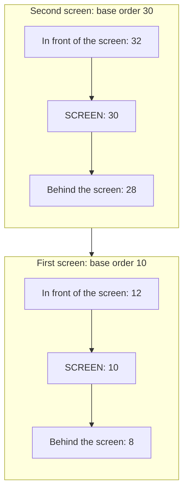
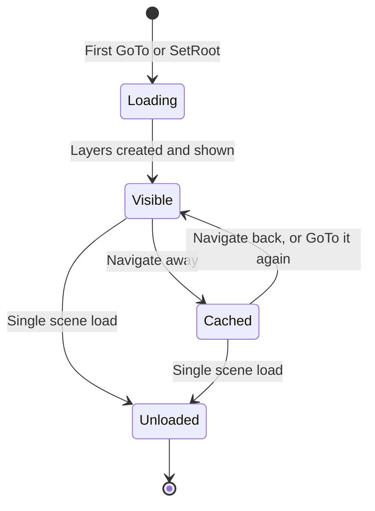

# Core Concepts

[← Back to README](../README.md)

How Screen System works, and why it's built the way it is.

- [Glossary](#glossary)
- [Layers](#layers)
- [Rendering](#rendering)
- [Memory](#memory)
- [Screen lifetime](#screen-lifetime)
- [Architecture](#architecture)
- [By design](#by-design)

---

## Glossary

| Concept | Meaning |
|---|---|
| Layer | A prefab with its own `Canvas` or `UIDocument`, drawn as part of one or more screens |
| `LayerDefinition` | The ordered list of a screen's layers, edited in the Inspector |
| `ScreenDefinition` | An asset holding a screen's ID, asset path, type, framework and behavior |
| `ScreenRegistry` | The lookup of available screens |
| `ScreenManager` | The entry point for navigation |
| `LayerComponent` | Handles a layer's runtime behavior |
| Screen feature | A folder with one folder per screen and a `Services` folder for its `ScreenDefinition` assets |
| Screen type | `Fullscreen`, `Modal` or `Alert` |
| Framework | `uGUI`, `UIToolkit` or `Both` |

## Layers

A screen is a prefab plus an ordered list of layers, like layers in an image editor. In the `LayerDefinition` inspector, you drag layer prefabs into a list and reorder them. Layers above the `SCREEN` entry draw behind the screen, and layers below it draw in front.

- **Reuse instead of duplicating.** A top bar, a navigation bar or a shop background is one prefab that any screen can list. Change it once, and every screen that uses it changes.
- **One instance per shared layer.** When two screens list the same layer, they share one instance. In a test project with 8 screens, 20 layer references resolved to 12 instances.
- **No sort orders to manage.** The system sets each layer's sorting order from its position in the list and its screen's depth in the stack.

### Draw order

Higher numbers draw on top, so the diagram reads from front to back. Each screen's base order is `10 + 20 × its depth`, and each step away from `SCREEN` adds or subtracts `2`.

### Shared layers

A shared layer:

- Uses the draw order of the topmost screen that's using it
- Stays visible when you navigate between two screens that use it
- Keeps its content and state, rather than loading a copy for each screen
- Doesn't get `OnScreenShown` or `OnScreenHidden` again when you move between two screens that share it, so anything it started keeps running

### uGUI and UI Toolkit

Each screen, and each layer, picks its framework. Both work in the same project at the same time when the canvas uses Screen Space - Overlay, which is the default.

## Rendering

Only what's visible is rendered.

- **At most three windows render at once:** one fullscreen screen, one modal over it and one alert over the modal. Opening a fullscreen screen hides the one under it.
- **Modals don't redraw the screen behind them.** Before a modal or alert becomes visible, the screen is captured at the end of the frame, blurred at a quarter of its resolution and darkened. That image is placed just below the modal, and the screen's layers stop rendering without being hidden, so their callbacks don't run. Behind the modal there's one image instead of a whole screen. Layers the modal shares, such as a navigation bar, keep rendering. An alert over a modal only dims the modal. Blur strength, resolution, darkening and the alert dim are set in [`ScreenSystemSettings`](editor-tools.md#settings).
- **Hiding keeps state.** Hidden screens stay loaded. A hidden uGUI layer only has its `Canvas` disabled, and a hidden UI Toolkit layer has its root set to `display: none`. Neither rebuilds its hierarchy or visual tree when it's shown again, and reopening a screen reuses the same objects.
- **No per-frame work.** Nothing polls or runs on a timer, and navigation is event-driven.

## Memory

All UI lives in one persistent object, so scenes hold no UI and load faster.

- **Loads only what's asked for.** A screen loads when it's requested, never ahead of time. The first time it opens, its layers that aren't in the scene yet load together, and prefabs in local Addressables bundles finish loading in the same frame. Layers already in the scene aren't loaded again.
- **Automatic unloading.** On a single scene load, every screen is unloaded except those marked **Persist Over Scenes**, the splash screen and the quit confirmation. They're destroyed, their Addressables handles are released and their assets are unloaded.
- **No hitch on the next scene's first screen.** Unused assets are unloaded after the new scene's first screen is drawn, so its load doesn't wait for that work.
- **No leaks across scene changes.** Memory stays flat over 12 scene changes on four phones, with no Addressables handle left behind. See [Performance](performance.md).
- **Addressables handles.** Each address has one handle, held while a screen uses it. AssetBundles stay open for the session once a screen needs them, while their assets load and unload with the screens. Closing and reopening a bundle on every scene change cost about 29 MB of native memory per change on a Pixel 5.
- **Resources or Addressables.** A screen's asset path is tried in Resources first, then Addressables.

## Screen lifetime

Persistent screens, the splash and the quit confirmation skip the `Unloaded` state.

Going back to a screen with `GoBack`, `PopTo`, or `GoTo` for a screen already in the stack removes the screens above it from the stack. They stay cached, hidden, until they're opened again or the scene changes.

## Architecture

- **One persistent object.** Screen System runs from one `ScreenSystem` object, created before the first scene loads and marked `DontDestroyOnLoad`.
- **One entry point.** A game has one UI, so there's one `ScreenManager`. `ScreenManager.Instance` is the entry point, and `await ScreenManager.WhenReadyAsync()` waits for it without polling. To test your own code, depend on `IScreenNavigationService`, which `ScreenManager` implements, and pass a fake in your tests.
- **Features never manage UI state.** Feature code calls `GoTo("Shop")`. The system loads the screen, keeps the back stack, renders only what's visible, and unloads what the next scene doesn't need.
- **Any DI container, or none.** Screen System only uses two interfaces from Tools Core. See [Dependency Injection](dependency-injection.md).
- **Adopt it incrementally.** It stays out of the way until you open one of its screens, so it can live beside hand-made UI. See [Migrating an existing project](migration.md).

## By design

- **Calls during a transition are ignored, never queued.** A navigation call made while another is running returns `Transitioning` and logs which call is running. A queue would replay taps the player made while a screen was loading, and could open screens they no longer want. Check `IsTransitioning` if you need to know.
- **One modal and one alert at a time.** At most one fullscreen screen, one modal and one alert render at once, which keeps overdraw low, and back always has one obvious thing to close. See [One modal and one alert at a time](code-examples.md#one-modal-and-one-alert-at-a-time).
- **No screen transitions or animations.** Transitions depend on each game's art direction, so animations belong to the layers: an intro from `OnScreenShown()`, and an outro played before calling `GoTo`. See [Animate a screen](code-examples.md#animate-a-screen).
- **The stack never holds the same screen twice.** `GoTo` for a screen already in the stack returns to it, like `PopTo`.
