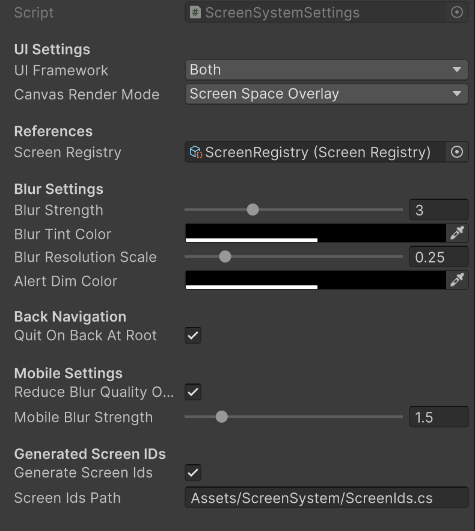

# Editor Tools & Settings

[← Back to README](../README.md)

- [Editor tools](#editor-tools)
- [Settings](#settings)

---

## Editor tools

| Command | Purpose |
|---|---|
| `Tools/Screen System/Setup` | Create the required project assets, the modal backdrop and the special screens. Running it again repairs them. |
| `Tools/Screen System/Documentation` | Open this documentation in the browser |
| `ScreenManager` Inspector > **Create Special Screens** | Create the splash and quit confirmation screens that are missing |
| `ScreenRegistry` Inspector > **Rebuild Registry from Assets** | Repair the registry. It already updates when `ScreenDefinition` assets change. |
| `ScreenManager` Inspector > **Open Screen Manager Window** | In Play Mode: what the next back does, what's rendering now from front to back (with the blur or dim), the back stack down to the root with each screen's layers, and Back, Dismiss Alert, Close All and Pop To buttons |
| `ScreenManager` Inspector > **Run Benchmark In Play Mode** | Measure your screens (after importing the Benchmark sample). See [Performance](performance.md). |
| `Assets/Screen System/New Screen Feature` | Create screens, ready for `GoTo`, in the folder you right-clicked. The folder is the feature: its name prefixes the screen IDs |
| `Assets/Screen System/New Layer` | Ask for a name and create a layer prefab in the selected folder: a Canvas with a full-screen Image, marked Addressable with its name as the address |
| `ScreenDefinition` Inspector > **Edit Prefab** | Open the screen's prefab |
| `ScreenDefinition` Inspector > **Add Screen to Feature…** | Add screens to the feature the definition belongs to |

In the Unity Profiler, the package's steps appear as `ScreenSystem.*` markers, such as `ScreenSystem.LoadPrefab` and `ScreenSystem.ActivateLayers`.

## Settings

Setup creates `ScreenSystemSettings` in `Assets/Resources/Tools/Screen System/Scriptables/`. Select it to change these:

| Setting | What it does |
|---|---|
| **UI Framework** | The frameworks your screens use: `uGUI`, `UIToolkit` or `Both`. Each layer's framework is detected from its own components, so this rarely needs changing. With `UIToolkit` only, **Canvas Render Mode** isn't applied. |
| **Canvas Render Mode** | The render mode of every uGUI layer's `Canvas`. `Screen Space - Overlay`, the default, is the tested one, and the blur behind modals assumes it. See [Does it work with Screen Space - Camera or World Space canvases?](faq.md#does-it-work-with-screen-space---camera-or-world-space-canvases) |
| **Screen Registry** | The registry of every `ScreenDefinition`. Setup assigns it, and it updates itself when screens change. |
| **Blur Strength** | How blurred the snapshot behind a modal or alert is, from 0 to 10. Higher is blurrier, and costs the same. |
| **Blur Tint Color** | Darkens and tints that snapshot. Its alpha is the strength: 0 keeps only the blur, 1 is a solid color. |
| **Blur Resolution Scale** | The snapshot's resolution, as a fraction of the screen. Lower is cheaper and blurrier; the default is a quarter. |
| **Alert Dim Color** | The color between a modal and an alert opened over it. The modal stays visible and is only darkened, not blurred. |
| **Quit On Back At Root** | On, back at the root opens the `QuitConfirmation` modal, or quits if there isn't one. Off, it only raises `NavigationEvents.OnBackAtRoot`. See [Handle back at the root](code-examples.md#handle-back-at-the-root). |
| **Reduce Blur Quality On Mobile** | On Android and iOS, use **Mobile Blur Strength** instead of **Blur Strength**. |
| **Mobile Blur Strength** | The blur strength on Android and iOS while the setting above is on. |
| **Generate Screen IDs** | Writes the `ScreenIds` class, with one constant per screen. See [Screen IDs](api-reference.md#screen-ids). |
| **Screen IDs Path** | Where `ScreenIds` is written. If your code is in an assembly definition, put it inside that assembly's folder. |

The blur settings and **Quit On Back At Root** are read each time they're used, so changes apply to the next modal or back press, even in Play Mode. **Canvas Render Mode** applies to layers loaded after the change.

Informational logs aren't a setting: define `SCREEN_SYSTEM_VERBOSE` in **Player Settings > Scripting Define Symbols** to compile them in. Warnings and errors always show.
