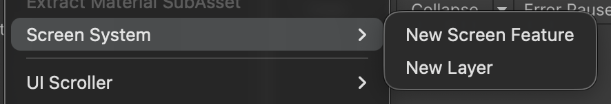

<div align="center">

# Unity Screen System

<sub>DESIGNED & BUILT BY</sub><br>
**✦ [`SANTIAGO GONZÁLEZ ROZO (@sgonzalezrozo)`](https://github.com/sgonzalezrozo) ✦**

A layer-based UI manager for uGUI and UI Toolkit: shared layers with automatic draw order, only what's visible renders, and everything unloads on scene change. 1–5 ms cached shows.

[](Documentation~/getting-started.md#requirements)
[](CHANGELOG.md)
[](LICENSE)

[**Installation**](#installation) • [**Key Features**](#key-features) • [**Quickstart**](#quickstart) • [**Code Examples**](Documentation~/code-examples.md) • [**Core Concepts**](Documentation~/core-concepts.md) • [**API Reference**](Documentation~/api-reference.md)

<sub>[Getting Started](Documentation~/getting-started.md) • [Editor Tools](Documentation~/editor-tools.md) • [Performance](Documentation~/performance.md) • [Migration](Documentation~/migration.md) • [Dependency Injection](Documentation~/dependency-injection.md) • [AI Agents](Documentation~/ai-agents.md) • [Troubleshooting](Documentation~/troubleshooting.md) • [FAQ](Documentation~/faq.md) • [Project Status](Documentation~/project-status.md)</sub>

</div>

---

## Installation

Screen System depends on [Tools Core](https://github.com/sgonzalezrozo/unity-tools-core). Unity doesn't install Git dependencies automatically, so add both, in this order:

1. Open **Window > Package Manager** in Unity.
2. Click **`+`** in the top-left corner and select **Add package from git URL...**
3. Paste each URL below and click **Add**:

```text
https://github.com/sgonzalezrozo/unity-tools-core.git
```

<sub>* Tools Core is needed only by Screen System, Fast IoC and UI Scroller. Add it once, even if you use several of them.</sub>

```text
https://github.com/sgonzalezrozo/unity-screen-system.git
```

Requirements and tested platforms: [Getting Started](Documentation~/getting-started.md#requirements).

---

## Key Features

* **[Screens built from layers](Documentation~/core-concepts.md#layers)**: a screen is a prefab plus an ordered list of layers, like layers in an image editor.
  A top bar or background is one prefab that any screen can list. Screens share one instance, and draw order is set for you.
* **[Only what's visible renders](Documentation~/core-concepts.md#rendering)**: at most one fullscreen, one modal and one alert render at once.
  Behind a modal, a blurred snapshot replaces the screen, and nothing runs per frame.
* **[Memory that cleans itself up](Documentation~/core-concepts.md#memory)**: screens load on request and unload on scene change.
  Addressables handles are released, with no leaks across scene changes.
* **[Measured on real devices](Documentation~/performance.md)**: 1–5 ms cached shows on four phones with IL2CPP.
  A benchmark sample runs the same measurements on your own screens.
* **[Fits into your project](Documentation~/core-concepts.md#architecture)**: uGUI, UI Toolkit or both; Resources or Addressables; any DI container or none.
  Adopt it [one menu at a time](Documentation~/migration.md) beside your existing UI.

---

## Quickstart

1. Run **Tools > Screen System > Setup**, and click **Create** to add the splash and quit confirmation screens.
2. Create a folder named `Shop`, right-click it in the Project window and select **Screen System > New Screen Feature**. Add two `Fullscreen` screens, `ShopMain` and `ShopDetail`, and click **Create**. The folder is the feature: its name prefixes the screen IDs.

    New Screen Feature and New Layer" width="420">

3. Open the screen from any script:

```csharp
ScreenManager screens = await ScreenManager.WhenReadyAsync();
await screens.SetRoot("ShopMain");          // first screen
await screens.GoTo("ShopDetail");           // push another
await screens.GoBack();                     // and back
```

<details>
<summary><strong>View full sample script</strong></summary>

```csharp
using System;
using ScreenSystem;
using UnityEngine;

// Add to any object in your first scene.
public class GameBoot : MonoBehaviour
{
    private async void Start()
    {
        try
        {
            ScreenManager screens = await ScreenManager.WhenReadyAsync();
            if (screens != null)
                await screens.SetRoot("ShopMain");
        }
        catch (Exception exception)
        {
            Debug.LogException(exception);
        }
    }
}

// Add to the ShopMain prefab and wire the methods to buttons.
public class ShopMainScreen : MonoBehaviour, IScreenLifecycle
{
    public void OpenDetail() => ScreenManager.Instance.GoTo("ShopDetail").Forget("Open detail");
    public void Back() => ScreenManager.Instance.GoBack().Forget("Back");

    // Use these instead of OnEnable/OnDisable: hidden layers stay active.
    public void OnScreenShown() => Debug.Log("Shop shown");
    public void OnScreenHidden() => Debug.Log("Shop hidden");
}
```

</details>

The full walkthrough is in [Getting Started](Documentation~/getting-started.md).
