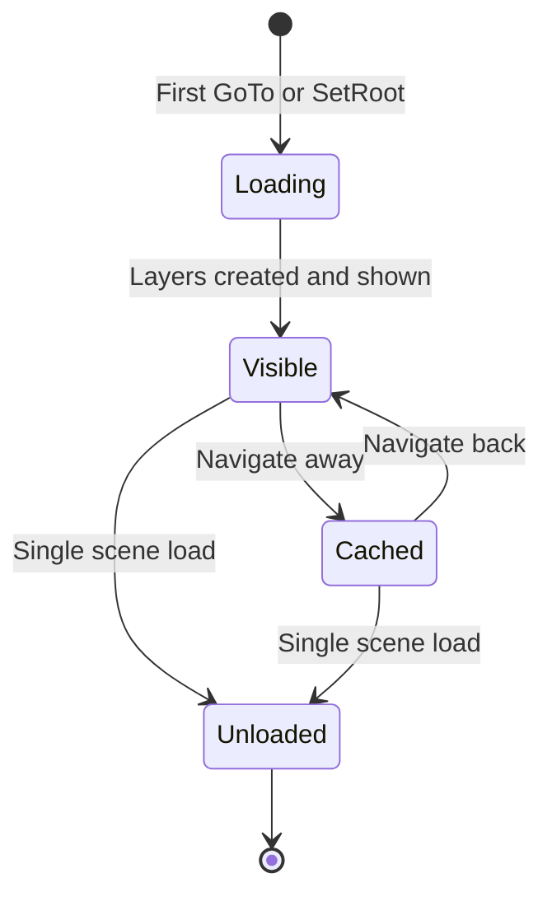
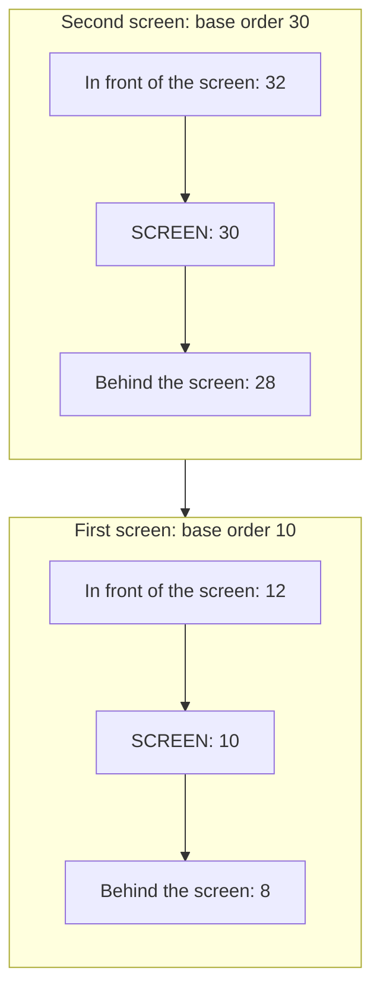

# Screen System

**Declarative UI navigation for Unity. Feature code asks for a screen, and the system handles the rest.**

[](LICENSE)
[](#compatibility)
[](CHANGELOG.md)

Screen System is a free, open-source UI manager for Unity 6 that handles screen navigation, popups and modals, for uGUI and UI Toolkit. Feature code calls `ScreenManager.Instance.GoTo("Shop")`, and the system loads the screen from Resources or Addressables, keeps a back stack, and handles fullscreen, modal and alert layers, the Escape key and cleanup on scene changes. Features don't manage navigation themselves.

<!-- Demo GIF: Documentation~/images/demo.gif -->

## Why I built it

Most projects I worked on had no formal layer controller. Their screens repeated other prefabs instead of reusing them, even with nested and variant prefabs.

My first time using one was on a recent project, with a custom layer system. That experience, and remembering how apps like Photoshop handle layers, made me want my own tool: a more robust system that covers all my use cases without time-based loops or other detection routines that hurt the game's performance.

I built it for uGUI. With the canvas set to overlay, it also works with uGUI and UI Toolkit at the same time.

I built and refined it on my own time in personal projects. It isn't used in production yet. In November 2026 I extracted it into this standalone package and documented it. Earlier history lives in a private repository.

## Is it right for your project?

**Use Screen System if you:**

- Have many screens, overlays or dialogs
- Want one source of truth for the back stack
- Use uGUI, UI Toolkit or both
- Want editor scaffolding and diagnostics

**Consider something else if you:**

- Have only a few screens and simple scene transitions
- Need to pass data through navigation calls. `GoTo` currently takes only a screen ID.

## Features

- `GoTo`, `GoBack`, `SetRoot` and `PopTo` navigation
- Fullscreen, modal and alert screen types
- Automatic layer ordering, including layers shared between screens
- Screens kept loaded and reused until their scene ends
- Optional screens that persist across scene changes
- Guarded async navigation, which ignores calls made during a transition
- uGUI and UI Toolkit screen frameworks
- Screens loaded from Resources or Addressables
- Back handling with Escape through the Input System
- Navigation and transition events
- Optional background blur and glass effects
- Feature scaffolding, a registry and a Screen Manager window

## Compatibility

| Requirement | Supported |
|---|---|
| Unity | Tested on Unity 6 (`6000.3.16f1`). The package declares `2022.3` as its minimum, but older versions aren't tested yet. |
| Scripting backend | Not verified yet |
| Platforms | Not verified yet |
| UI frameworks | uGUI, UI Toolkit, or both at once when the canvas uses Screen Space - Overlay, which is the default |
| Enter Play Mode with domain reload disabled | Not verified yet. The package has no static reset for this mode, so keep domain reload on until you've tested it. |
| Dependencies | [Tools Core](https://github.com/sgonzalezrozo/unity-tools-core), uGUI, Addressables, Input System |

## Installation

Git must be installed on your machine.

### 1. Install Tools Core

This package requires [Tools Core](https://github.com/sgonzalezrozo/unity-tools-core), the shared code that defines the injection interfaces used by Fast IoC, Screen System and Recyclable Scroller. Unity doesn't install Git dependencies automatically, so add it first.

1. In Unity, open **Window > Package Manager**.
2. Select **+ > Add package from git URL**.
3. Enter:

```text
https://github.com/sgonzalezrozo/unity-tools-core.git
```

### 2. Install this package

1. In Unity, open **Window > Package Manager**.
2. Select **+ > Add package from git URL**.
3. Enter:

```text
https://github.com/sgonzalezrozo/unity-screen-system.git
```

To pin a release, add its tag:

```text
https://github.com/sgonzalezrozo/unity-screen-system.git#v0.3.0
```

## Setup

1. Run **Tools > Screen System > Setup**.
2. Confirm that its settings, registry and `ScreenSystem` prefab are in `Assets/Resources/Tools/Screen System/`.

The prefab is created automatically before the first scene loads, so you don't need to add it to a scene.

## Create your first screen

1. In the Project window, select a folder for the feature.
2. Select **Assets > Screen System > New Screen Feature**.
3. Finish the wizard. It creates `Screens` and `Prefabs` folders with a `ScreenDefinition` and a prefab.
4. On the `ScreenDefinition`, check its screen type and framework. Its name, ID and asset path are filled in from the prefab.
5. Run **Tools > Screen System > Rebuild Registry Cache**.

### What's on a screen prefab

The wizard adds these for you. If you build a prefab by hand, add them yourself:

| Framework | Required on the prefab root |
|---|---|
| uGUI | `Canvas`, `GraphicRaycaster`, `CanvasGroup`, a stretched `RectTransform` and `LayerDefinition` |
| UI Toolkit | `UIDocument` and `LayerDefinition` |

`LayerComponent` is added when the screen loads, if the prefab doesn't have it. For UI Toolkit, also assign your UXML and the `GlobalPanelSettings` asset that Setup creates in `Assets/Resources/Tools/Screen System/Prefabs/`.

### React to a screen opening or closing

Add a component like this to the prefab:

```csharp
using ScreenSystem;
using UnityEngine;

public class SettingsScreen : MonoBehaviour, IScreenLifecycle
{
    public void OnScreenShown()
    {
        Debug.Log("Settings shown");
    }

    public void OnScreenHidden()
    {
        Debug.Log("Settings hidden");
    }
}
```

Implement only `IScreenShow` or `IScreenHide` if you need just one callback. A component can also implement `IScreenContent` for `InitializeAsync()` and `Cleanup()`.

## Open the first screen

`ScreenManager.Instance` is set in `Start()`, so wait for it before navigating:

```csharp
using System;
using System.Threading.Tasks;
using ScreenSystem;
using UnityEngine;

public class GameBoot : MonoBehaviour
{
    private async void Start()
    {
        try
        {
            while (ScreenManager.Instance == null)
                await Task.Yield();

            await ScreenManager.Instance.WaitForInitializationAsync();
            await ScreenManager.Instance.SetRoot("ShopMain");
        }
        catch (Exception exception)
        {
            Debug.LogException(exception);
        }
    }
}
```

`async void` is used because `Start()` can't return a `Task` to a caller, so keep the `try`/`catch`.

## Usage examples

### Connect buttons to screens

Hook these methods up to UI buttons. `Forget` runs the navigation without waiting for it and logs any exception.

```csharp
using ScreenSystem;
using UnityEngine;

public class ShopMainScreen : MonoBehaviour
{
    public void OpenDetail() => ScreenManager.Instance.GoTo("ShopDetail").Forget("Open detail");
    public void OpenModal() => ScreenManager.Instance.GoTo("ShopModal").Forget("Open modal");
    public void Back() => ScreenManager.Instance.GoBack().Forget("Back");
}
```

`ShopModal` opens as a modal because its `ScreenDefinition` type is `modal`.

### Check the result

```csharp
bool opened = await ScreenManager.Instance.GoTo("ShopDetail");

if (!opened)
    Debug.LogWarning("ShopDetail didn't open.");
```

### Change scenes

Load scenes as usual. Screen System cleans up automatically when a new scene loads in single mode, so you don't need to call anything first.

```csharp
SceneManager.LoadScene("MainMenu");
```

This needs `using UnityEngine.SceneManagement;`.

### Open a modal

Set the `ScreenDefinition` type to `modal`, then use the same navigation calls:

```csharp
await ScreenManager.Instance.GoTo("ShopModal");
await ScreenManager.Instance.GoBack(); // Closes the modal.
```

- Only one modal is open at a time. Calling `GoTo` for another new screen fails until the modal closes.
- Calling `GoTo` for a screen already in the stack closes the modal and returns to that screen.

### Handle back at the root

`GoBack()` and the Escape key close an open modal first, then step back through the stack. At the root, Screen System opens a modal called `QuitConfirmation`. If that screen doesn't exist, the app quits straight away, and Play Mode stops in the Editor.

To confirm before quitting, create a modal screen named `QuitConfirmation`. You can change that name with **Quit Confirmation Modal Id** on the `ScreenManager`.

To react to the app quitting:

```csharp
NavigationEvents.OnQuitApplicationRequested += SaveGame;
```

### Keep a screen across scenes

Turn on **Persist Over Scenes** on the `ScreenDefinition`. This suits screens such as a loading overlay.

When a scene loads in single mode, a persistent screen stays loaded and its canvas is turned back on, but the navigation history is cleared.

### Show an alert

Set the `ScreenDefinition` type to `alert`, then open it with `GoTo`:

```csharp
await ScreenManager.Instance.GoTo("ConnectionLost");

// From the alert's button:
await ScreenManager.Instance.DismissAlert();
```

- An alert opens over everything, including modals, and isn't added to the navigation stack.
- While it's open, `GoTo`, `GoBack`, `PopTo` and `SetRoot` fail, and the Escape key does nothing. Call `DismissAlert()` to close it.
- Use `IsAlertActive` to check whether one is open.
- A single scene load closes the alert.

### Show a screen over a modal or alert

Turn on **Ignore Navigation Rules** on the `ScreenDefinition`. This suits splash screens and critical errors:

- A fullscreen screen opens on top and leaves the modal or alert open underneath. `GoBack()` closes that screen first.
- A modal screen replaces the open modal.

### Animate a screen

To animate a screen's entrance, start the animation from `OnScreenShown()`, as in the [UI Tweens example](https://github.com/sgonzalezrozo/unity-ui-tweens#usage-example). To run code around a transition, use the [transition events](#events).

Screens hide instantly, so exit animations aren't supported yet.

### Inject services into a screen

With [Fast IoC](https://github.com/sgonzalezrozo/unity-fast-ioc), add `internal` fields to any MonoBehaviour on the prefab or its children:

```csharp
using ScreenSystem;
using UnityEngine;

public class ShopMainScreen : MonoBehaviour, IScreenShow
{
    internal IInventoryService inventory;

    public void OnScreenShown()
    {
        Debug.Log($"Items: {inventory.ItemCount}");
    }
}
```

Bind `IInventoryService` in an installer. Fast IoC regenerates after your scripts compile.

### Add editor shortcuts

This needs `using UnityEngine.InputSystem;`.

```csharp
#if UNITY_EDITOR
private void Update()
{
    if (Keyboard.current?.digit1Key.wasPressedThisFrame ?? false)
        ScreenManager.Instance.GoTo("ShopMain").Forget("Open ShopMain");

    if (Keyboard.current?.digit2Key.wasPressedThisFrame ?? false)
        ScreenManager.Instance.GoTo("ShopDetail").Forget("Open ShopDetail");
}
#endif
```

## Navigation reference

All navigation methods return `Task<bool>` and take an optional `CancellationToken`.

```csharp
ScreenManager screens = ScreenManager.Instance;

await screens.GoTo("ShopDetail");
await screens.GoBack();
await screens.PopTo("ShopMain");
await screens.SetRoot("Lobby");
```

| Operation | Purpose |
|---|---|
| `GoTo(screen)` | Open a screen |
| `GoBack()` | Return to the previous screen |
| `PopTo(screen)` | Return to a screen already in the stack |
| `SetRoot(screen)` | Replace the root screen |
| `CanGoBack` | Check whether there's a screen to return to |
| `GetCurrentScreen()` | Get the current screen ID |
| `DismissAlert()` | Close the open alert |
| `IsAlertActive` | Check whether an alert is open |

Each `screen` argument can be the screen's name or its ID. The name comes from the prefab, such as `ShopMain`. The ID survives renames, and the wizard creates it from the feature and screen names, such as `Shop_ShopMain`. Names are the simpler choice, but they must be unique, because the first match wins.

## Navigation behavior

- **During a transition:** another navigation call is ignored and returns `false`.
- **Unknown screen ID:** an error or warning is logged, and the call returns `false`.
- **Active modal:** `GoTo` for a new screen fails until the modal closes. An alert or a screen with **Ignore Navigation Rules** can still open.
- **Active alert:** navigation fails until `DismissAlert()`, except for screens with **Ignore Navigation Rules**.
- **Back at the root:** `GoBack()` starts the [quit flow](#handle-back-at-the-root).
- **Escape key:** runs back navigation through the Input System.
- **Scene changes:** cleanup runs automatically when a scene loads in single mode. Additive loads don't change your screens. Screens with **Persist Over Scenes** stay available.
- **Asset loading:** a screen's asset path is tried in Resources first, then Addressables.

## Events

```csharp
NavigationEvents.OnNavigationCompleted += screenId => Debug.Log($"Opened {screenId}");
NavigationEvents.OnNavigationFailed += (screenId, reason) => Debug.LogWarning($"{screenId}: {reason}");
```

`NavigationEvents` also has `OnNavigationStarted`, `OnScreenPushed`, `OnScreenPopped`, `OnStackCleared`, `OnBackAtRoot` and `OnQuitApplicationRequested`. These events are static, so unsubscribe when your object is destroyed.

Four more events follow a screen's transitions:

| Event | Raised when |
|---|---|
| `OnTransitionInStarted` | A screen starts showing, before its layers load |
| `OnTransitionInCompleted` | Its layers and content are loaded and visible |
| `OnTransitionOutStarted` | A screen starts hiding |
| `OnTransitionOutCompleted` | Its layers are hidden |

## Dependency injection

Screen System works without a container, using standard `Instantiate`. With [Fast IoC](https://github.com/sgonzalezrozo/unity-fast-ioc), its components are injected automatically. See [Tools Core](https://github.com/sgonzalezrozo/unity-tools-core) for using another container.

The package exposes its internals to `Assembly-CSharp`, so Fast IoC `0.4.0` and later assign its `internal` fields (such as `injectedInstantiator`) directly, without reflection.

## How it works

Screen System runs from one persistent `ScreenSystem` object, marked `DontDestroyOnLoad`.

- **Loading:** a screen's layers load the first time it opens, then stay cached.
- **Showing and hiding:** hidden screens stay loaded, but their `Canvas` or `UIDocument` is disabled. Reopening one reuses the same objects.
- **Layers:** each screen is made of one or more layers, and each layer has its own `Canvas` or `UIDocument`. Layers can be shared between screens.
- **Draw order:** the system sets each layer's sort order from its position in the navigation stack and its `LayerDefinition`, so you don't set sort orders by hand.
- **Scene changes:** screens without **Persist Over Scenes** are destroyed, their cached resources are released, and unused assets are unloaded. Persistent screens are kept.

Each `ScreenDefinition` in the registry stores the settings that control this, so features don't manage these lifetimes themselves.

### A screen's lifetime



Screens with **Persist Over Scenes** skip the `Unloaded` state.

### Layers and draw order

A screen's prefab is its main layer. To add more, list them in its `LayerDefinition`. The `SCREEN` entry marks the main layer: entries above it draw behind the screen, and entries below it draw in front.



Higher numbers draw on top, so the diagram reads from front to back. Each screen's base order is `10 + 20 × its depth`, and each step away from `SCREEN` adds or subtracts `2`.

Extra layers are found by name, in Resources first and then Addressables.

### Shared layers

Layers are cached by name, so two screens that list the same name share one instance. A shared layer:

- Uses the draw order of the topmost screen that's using it
- Stays visible when you navigate between two screens that use it
- Keeps its content, rather than loading a copy for each screen

## Core concepts

| Concept | Meaning |
|---|---|
| Screen feature | A folder of screens created by the wizard |
| `ScreenDefinition` | An asset holding a screen's ID, asset path, type, framework and behavior |
| `ScreenRegistry` | The lookup of available screens |
| `ScreenManager` | The entry point for navigation |
| `LayerComponent` | Handles a layer's runtime behavior |
| `LayerDefinition` | Defines a screen's layers and their order |
| Screen type | `fullscreen`, `modal` or `alert` |
| Framework | `uGUI`, `UIToolkit` or `Both` |

## Editor tools

| Command | Purpose |
|---|---|
| `Tools/Screen System/Setup` | Create the required project assets |
| `Tools/Screen System/Rebuild Registry Cache` | Rebuild the registry from `ScreenDefinition` assets |
| `Tools/Screen System/Screen Manager Window` | Inspect screens and metrics |
| `Assets/Screen System/New Screen Feature` | Scaffold a new screen feature |
| `Assets/Screen System/Add Screen to Feature` | Add a screen to an existing feature |
| `GameObject/UI/Blur Background Layer` | Add a blur background layer |

## Recommended usage

- Keep screen names unique and stable.
- Use a single root screen for your app's boot flow.
- Prefer stack-based transitions over direct scene loads when UI should stay mounted.
- Rebuild the registry after adding or renaming screens.

## Use it with AI coding agents

Coding agents write C# files, and this package is newer than their training data. Give them its rules so they use the real API:

1. Copy [`Documentation~/agent-rules.md`](Documentation~/agent-rules.md) into your project's agent rules, for example `AGENTS.md`, `CLAUDE.md` or `.cursor/rules/screen-system.md`.
2. For a whole Unity architecture with a verify loop, add [Unity Architecture Agents](https://github.com/sgonzalezrozo/unity-architecture-agents). It detects this package and adapts its code.

There are no MCP tools for Screen System yet. The rules file works with any agent that reads project files.

## FAQ

### How do I manage UI screens, popups and modals in Unity?

Create each screen as a prefab with a `ScreenDefinition`, then navigate by name: `await ScreenManager.Instance.GoTo("ShopDetail")`. Screen System keeps the back stack and the modal and alert layers. See [Create your first screen](#create-your-first-screen).

### How do I go back to the previous screen?

Call `await ScreenManager.Instance.GoBack()`. The Escape key does the same through the Input System. See [Navigation reference](#navigation-reference).

### Does it work with uGUI and UI Toolkit?

Yes. Each `ScreenDefinition` sets its framework.

### Does it load screens with Addressables?

Yes. A screen's asset path is tried in Resources first, then Addressables.

### Does it work with Unity 6?

Yes. It's tested on Unity `6000.3`. The package declares `2022.3` as its minimum, but older versions aren't tested yet.

### Does it work with IL2CPP and mobile?

Not verified yet. See [Compatibility](#compatibility).

### Can I pass parameters to a screen?

Not through navigation calls yet. See [Limitations](#limitations).

### Does it work with dependency injection?

Yes. It works without a container, and [Fast IoC](https://github.com/sgonzalezrozo/unity-fast-ioc) injects its components automatically. See [Dependency injection](#dependency-injection).

### Does it work with AI coding agents?

It ships a rules file you copy into your project, so agents use its real API instead of guessing. It hasn't been tested with agents beyond the author's own projects. See [Use it with AI coding agents](#use-it-with-ai-coding-agents).

### Should I use scenes or prefabs for UI screens?

Screen System uses prefabs, so UI stays loaded across navigation and a back stack is cheap. Load a scene when the game world changes, not for each menu. Screens marked **Persist Over Scenes** stay available across scene loads.

### How do I show a confirmation popup or an alert?

Give the screen a modal or alert type on its `ScreenDefinition`, then open it with `GoTo`. Close an alert with `DismissAlert()`. See [Navigation behavior](#navigation-behavior).

### How do I install it?

In Unity, open **Window > Package Manager**, select **+ > Add package from git URL** and enter `https://github.com/sgonzalezrozo/unity-screen-system.git`. Install [Tools Core](https://github.com/sgonzalezrozo/unity-tools-core) first, because Unity doesn't install Git dependencies automatically. See [Installation](#installation).

### Is it production-ready? Does anyone use it?

Not yet. Screen System is a pre-release package (`0.x`) by a single author. It isn't used in a shipped game, and it has no other users yet, so expect rough edges and API changes before `1.0.0`. Bug reports are very welcome. See [Project status](#project-status).

### Is it free for commercial use?

Yes. It's MIT licensed.

## Troubleshooting

| Problem | Try this |
|---|---|
| `TryResolveScreenId FAILED` or `screen not found` | Run **Rebuild Registry Cache** and check the screen name or ID |
| `ScreenSystem prefab not found` | Run **Tools > Screen System > Setup** |
| `AssetPath is EMPTY` | Set the screen's asset path on its `ScreenDefinition` |
| `GoTo` does nothing | Check whether a transition, modal or alert is blocking it |
| Escape quits the app | Create a `QuitConfirmation` modal, as shown in [Handle back at the root](#handle-back-at-the-root) |
| An `alert` screen won't close | Call `DismissAlert()`, because back navigation doesn't close alerts |
| `ScreenManager.Instance` is `null` | Wait for it as shown in [Open the first screen](#open-the-first-screen) |

## Limitations

- Navigation calls can't pass parameters to a screen.
- Modals can't return a result through `GoTo`.
- Screens are requested by string, so typos are only caught at runtime.
- Calls made during a transition are ignored, not queued.
- Only one alert can be open at a time.
- Screens hide instantly, so there are no exit animations.
- Only one modal can be open at a time.

## Project status

This is a pre-release package at version `0.3.0`. Its API and behavior may change before `1.0.0`. Not yet used in a shipped game.

Until `1.0.0`, minor versions (`0.x.0`) can include breaking changes, and patch versions (`0.x.y`) don't. Breaking changes are marked **Breaking** in the [changelog](CHANGELOG.md).

There's no public roadmap yet. Known gaps are listed under [Limitations](#limitations), and planned work is tracked in [issues](https://github.com/sgonzalezrozo/unity-screen-system/issues).

## Contributing

Bug reports and pull requests are welcome. Please open an issue before starting a large change. See the [contributing guide](.github/CONTRIBUTING.md) and [security policy](.github/SECURITY.md).

## Related packages

| Package | Purpose |
|---|---|
| [Fast IoC](https://github.com/sgonzalezrozo/unity-fast-ioc) | Code-generated dependency injection |
| [UI Tweens](https://github.com/sgonzalezrozo/unity-ui-tweens) | ECS-based UI animation |
| [Recyclable Scroller](https://github.com/sgonzalezrozo/unity-recyclable-scroller) | Virtualized lists |
| [Enhanced Console](https://github.com/sgonzalezrozo/unity-enhanced-console) | Unity Editor log triage |
| [Tools Core](https://github.com/sgonzalezrozo/unity-tools-core) | Shared injection code, required by this package |

## License

Released under the [MIT License](LICENSE).
