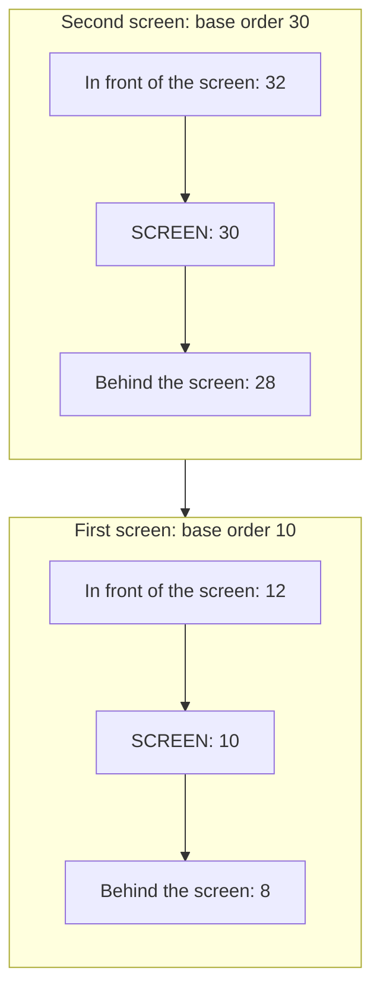
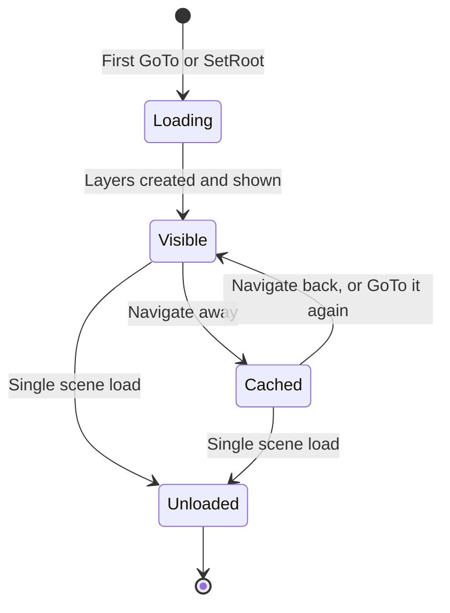

# Screen System

**Build Unity screens from reusable layers, like layers in an image editor. Ask for a screen by name, and the system loads it, orders it, hides what it covers and unloads it when the scene changes.**

[](LICENSE)
[](#compatibility)
[](CHANGELOG.md)

Screen System is a free, open-source UI manager for Unity 6, for uGUI and UI Toolkit. Each screen is a stack of layers: a background, the screen itself, a top bar, a navigation bar. Screens share layers instead of copying them, and the system sets every layer's draw order from where the screen sits in the navigation stack.

Feature code calls `ScreenManager.Instance.GoTo("Shop")`. The system loads the screen from Resources or Addressables, keeps the back stack, renders only what's visible, and unloads everything the next scene doesn't need. Features never manage navigation, visibility or memory themselves.

<!-- Demo GIF: Documentation~/images/demo.gif -->

## Why use it

### Screens built from layers

A screen is a prefab plus an ordered list of layers. In the `LayerDefinition` inspector, you drag layer prefabs into a list and reorder them. Layers above the `SCREEN` entry draw behind the screen, and layers below it draw in front.

- **Reuse instead of duplicating.** A top bar, a navigation bar or a shop background is one prefab that any screen can list. Change it once, and every screen that uses it changes.
- **One instance per shared layer.** When two screens list the same layer, they share one instance. In a test project with 8 screens, 20 layer references resolved to 12 instances.
- **No sort orders to manage.** The system sets each layer's sorting order from its position in the list and its screen's depth in the stack. A shared layer takes the order of the topmost screen that uses it.
- **Shared layers stay put.** Moving between two screens that share a top bar keeps the bar visible and keeps its state. It doesn't get `OnScreenShown` or `OnScreenHidden` again, so anything it started keeps running.

### Memory that cleans itself up

All UI lives in one persistent object, so scenes hold no UI and load faster.

- **Automatic unloading.** On a single scene load, every screen is unloaded except those marked **Persist Over Scenes**, the splash screen and the quit confirmation. Their Addressables handles are released and their assets are unloaded.
- **No hitch on the next scene's first screen.** Unused assets are unloaded after the new scene's first screen is drawn, so its load doesn't wait for that work.
- **No leaks across scene changes.** Memory stays flat over 12 scene changes on a Pixel 5, with no Addressables handle left behind.
- **Loads only what's asked for.** A screen loads when it's requested, never ahead of time. Its missing layers load together, and layers already in the scene aren't loaded again.

### Only what's visible is rendered

- **At most three windows render at once:** one fullscreen screen, one modal over it and one alert over the modal. Opening a fullscreen screen hides the one under it.
- **Modals don't redraw the screen behind them.** When a modal or alert opens, a blurred, darkened snapshot of the screen takes its place and the screen stops rendering until the modal closes. Behind the modal there's one image instead of a whole screen. An alert over a modal only dims the modal.
- **Hiding keeps state.** A hidden uGUI layer only has its `Canvas` disabled, and a hidden UI Toolkit layer has its root set to `display: none`. Neither rebuilds its hierarchy or visual tree when it's shown again.
- **No per-frame work.** Nothing polls or runs on a timer, and navigation is event-driven.

### One API for uGUI and UI Toolkit

Each screen, and each layer, picks its framework. Both work in the same project at the same time when the canvas uses Screen Space - Overlay, which is the default.

### Tools included

Setup in one command, a wizard that creates screens ready to open, a registry that updates itself, a Screen Manager window with the live stack and metrics, a layer editor, EditMode tests and a benchmark that runs on your own screens.

## Performance

Measured with the [Benchmark sample](Samples~/Benchmark/README.md) on the screens of a test project: 8 screens mixing uGUI and UI Toolkit, two scenes, Addressables. IL2CPP Development builds at 30 fps.

| Measure | Pixel 5 (Android 14) | Galaxy A02s (Android 12) |
|---|---|---|
| Show a cached screen | 2.6 ms, no frame waited | 3.9 ms |
| Show a screen that isn't loaded | 15 ms median | 30 ms median |
| Go back | 2.4 ms | 3.1 ms |
| Open a modal, with its blurred snapshot | 36 ms (one frame) | 38 ms (one frame) |
| Capture and blur the snapshot (main thread) | 0.2 ms | 0.4 ms |
| Scene change until the new scene's first screen is visible | 133 ms, of which 76 ms is Unity's scene activation | 224 ms, of which 96 ms is Unity's |
| Allocations per cached show, uGUI and UI Toolkit | 33 to 40 KB | 26 to 30 KB |
| Memory after 12 scene changes | flat (207.3 MB to 208.1 MB) | flat (190.0 MB to 190.4 MB) |
| Addressables handles left behind | 0 | 0 |
| Fullscreen screens rendering under an open modal | 0 | 0 |
| Navigations that broke the three-window rule | 0 of 264 | 0 of 264 |

Run it on your project with **Tools > Screen System > Benchmark > Run In Play Mode**, or on a device from the sample. [What each metric means](Documentation~/benchmarks/README.md).

## Is it right for your project?

**Use Screen System if you:**

- Have many screens, overlays or dialogs that share parts
- Want one source of truth for the back stack
- Use uGUI, UI Toolkit or both
- Load content with Addressables and care about memory across scenes
- Want editor scaffolding, diagnostics and measurable performance
- Have a project in progress with hand-made UI: you can [migrate one menu at a time](#adopt-it-in-a-project-that-already-has-ui)

**Consider something else if you:**

- Have only a few screens and simple scene changes

## Adopt it in a project that already has UI

You don't have to migrate everything at once. Screen System stays out of the way until you open a screen, so your hand-made menus and its screens can live side by side while you move them over one at a time.

**What installing it changes:** one `ScreenSystem` object is created in DontDestroyOnLoad. It opens nothing until you call `GoTo` or `SetRoot`, ignores the back key while none of its screens is open, uses your scene's `EventSystem`, and only unloads its own screens on scene changes. Your scene UI is untouched.

### Migrate one menu

1. Run **Tools > Screen System > Setup**, then turn off **Quit On Back At Root** in `ScreenSystemSettings`. While your main menu is still hand-made, back at the first Screen System screen should return to it, not quit.
2. Create the screen with **Assets > Screen System > New Screen Feature** and move the panel's content into its prefab. Move its `OnEnable`/`OnDisable` code to `IScreenShow`/`IScreenHide`.
3. Replace the code that showed and hid the panel:

```csharp
// Before
shopPanel.SetActive(true);
shopPanel.SetActive(false);

// After
await ScreenManager.Instance.GoTo("Shop");
await ScreenManager.Instance.GoBack();
```

4. Hand back to your UI when the player backs out of the first Screen System screen:

```csharp
private void OnEnable() => NavigationEvents.OnBackAtRoot += ReturnToMenu;
private void OnDisable() => NavigationEvents.OnBackAtRoot -= ReturnToMenu;

private async void ReturnToMenu()
{
    try
    {
        await ScreenManager.Instance.CloseAll(); // hides every screen and empties the stack
        mainMenuPanel.SetActive(true);           // your hand-made menu
    }
    catch (Exception ex)
    {
        Debug.LogException(ex);
    }
}
```

Closed screens stay loaded until the next scene change, so opening them again is fast.

### While both kinds of UI are on screen

- **Draw order:** Screen System's canvases are Screen Space Overlay with sorting orders from 10 up. Keep your overlay canvases below 10 to draw behind its screens, or well above to draw over them, such as a HUD or a loading curtain.
- **Back key:** while a Screen System screen is open, it handles Escape and Android back. Your own back handler should skip when `ScreenManager.Instance.GetCurrentScreen()` isn't `null`.
- **Visibility:** don't `SetActive` a screen's objects yourself. Open and close it through `ScreenManager`.

### When the last menu is migrated

Open your first screen with `SetRoot` at boot, turn **Quit On Back At Root** back on, add a [`QuitConfirmation` modal](#handle-back-at-the-root), and remove the `OnBackAtRoot` handler.

## Features

- `GoTo`, `GoBack`, `PopTo` and `SetRoot` navigation, by screen name or ID
- Screens composed from ordered, shareable layers, with automatic draw order
- Fullscreen, modal and alert screen types
- Screens kept loaded and reused until their scene ends, and unloaded automatically after it
- Optional screens that persist across scene changes
- Guarded async navigation: a call made while another is running is ignored, logged and returns `Transitioning`
- uGUI and UI Toolkit screens, alone or together
- Loading from Resources or Addressables
- Back handling with Escape through the Input System
- Navigation and show/hide events, and lifecycle callbacks on layer components
- Profiler markers for each step, so the package shows up in the Unity Profiler
- A blurred, darkened snapshot behind modals and alerts that replaces the screen underneath
- Setup, feature scaffolding, a registry, a Screen Manager window and a layer editor
- A benchmark sample and EditMode tests

## Compatibility

| Requirement | Supported |
|---|---|
| Unity | Tested on Unity 6 (`6000.3.6f1`, `6000.3.16f1`). The package declares `2022.3` as its minimum, but older versions aren't tested yet. |
| Scripting backend | Mono and IL2CPP |
| Platforms | Targets mobile and WebGL. Tested in the Editor (macOS) and on Android: a Pixel 5 (Android 14) and a Samsung Galaxy A02s (Android 12). iOS and WebGL aren't verified yet; on WebGL, layers always load asynchronously, because WebGL fetches every bundle with a web request. |
| UI frameworks | uGUI, UI Toolkit, or both at once when the canvas uses Screen Space - Overlay, which is the default |
| Enter Play Mode with domain reload disabled | Supported. Verified across repeated Play sessions with domain and scene reload off: static state, events and the registry reset at the start of each session. |
| Dependencies | [Tools Core](https://github.com/sgonzalezrozo/unity-tools-core), uGUI, Addressables, Input System. No DI container is required. |

## Installation

Git must be installed on your machine.

### 1. Install Tools Core

This package requires [Tools Core](https://github.com/sgonzalezrozo/unity-tools-core), the shared code that defines the injection interfaces used by Fast IoC, Screen System and Recyclable Scroller. Unity doesn't install Git dependencies automatically, so add it first.

1. In Unity, open **Window > Package Manager**.
2. Select **+ > Add package from git URL**.
3. Enter:

```text
https://github.com/sgonzalezrozo/unity-tools-core.git
```

### 2. Install this package

1. In Unity, open **Window > Package Manager**.
2. Select **+ > Add package from git URL**.
3. Enter:

```text
https://github.com/sgonzalezrozo/unity-screen-system.git
```

To pin a release, add its tag:

```text
https://github.com/sgonzalezrozo/unity-screen-system.git#v0.3.0
```

## Setup

1. Run **Tools > Screen System > Setup**.
2. Confirm that its settings, registry and `ScreenSystem` prefab are in `Assets/Resources/Tools/Screen System/`.

Running Setup again repairs a project: it keeps your settings and prefab, and adds or rebuilds the backdrop behind modals.

The prefab is created automatically before the first scene loads, so you don't need to add it to a scene.

## Create your first screen

Two steps, about a minute:

1. In the Project window, right-click the folder that holds your features and select **Screen System > New Screen Feature**. Name the feature and its screens, and pick each screen's type: `fullscreen`, `modal` or `alert`.
2. Click **Create**, then call `ScreenManager.Instance.GoTo("ShopMain")` with your screen's name.

For a feature `Shop` with a screen `ShopMain`, the wizard creates:

```
Shop/
├── ShopMain/
│   └── ShopMain.prefab      Canvas or UIDocument, LayerDefinition. Put the screen's C# here too.
└── Services/
    └── ShopMain.asset       ScreenDefinition, ID "Shop_ShopMain"
```

It also marks the prefab Addressable, with its name as the address, and adds the screen to the registry. For UI Toolkit it creates an empty `ShopMain.uxml` and assigns it and the `GlobalPanelSettings` to the `UIDocument`.

To add a screen to an existing feature, right-click the feature folder, one of its screen folders or its `Services` folder and select **Screen System > Add Screen to Feature**.

The registry keeps itself up to date: creating, deleting, moving or renaming a `ScreenDefinition` updates it, and the console warns when two screens share a name or ID. **Tools > Screen System > Rebuild Registry Cache** is only needed to repair a registry.

### What's on a screen prefab

The wizard adds these for you. If you build a prefab by hand, add them yourself:

| Framework | Required on the prefab root |
|---|---|
| uGUI | `Canvas`, `GraphicRaycaster`, `CanvasGroup`, a stretched `RectTransform` and `LayerDefinition` |
| UI Toolkit | `UIDocument` and `LayerDefinition` |

`LayerComponent` is added when the screen loads, if the prefab doesn't have it. For a UI Toolkit prefab built by hand, also assign your UXML and the `GlobalPanelSettings` asset that Setup creates in `Assets/Resources/Tools/Screen System/Prefabs/`.

To use a prefab you built by hand, drag it onto the drop area of a `ScreenDefinition`. A prefab that isn't in `Resources` is marked Addressable.

## Compose a screen from layers

1. Make each reusable part a prefab with its own `Canvas` (uGUI) or `UIDocument` (UI Toolkit): a background, a top bar, a navigation bar.
2. Select the screen prefab and open its `LayerDefinition` in the Inspector.
3. Drag layer prefabs into the list. A prefab that isn't in `Resources` or Addressable is marked Addressable, with its name as the address. Keep the ones that should draw behind the screen above the `SCREEN` entry, and the ones that should draw in front below it.
4. Reorder the list to change the draw order.

Any screen that lists the same layer shares its instance.

### Layers and draw order



Higher numbers draw on top, so the diagram reads from front to back. Each screen's base order is `10 + 20 × its depth`, and each step away from `SCREEN` adds or subtracts `2`.

### Shared layers

A shared layer:

- Uses the draw order of the topmost screen that's using it
- Stays visible when you navigate between two screens that use it
- Keeps its content, rather than loading a copy for each screen

## React to a screen opening or closing

Hidden layers stay active, so Unity's `OnEnable` and `OnDisable` don't run when a screen is shown or hidden. Implement these interfaces on any component of the prefab instead:

```csharp
using ScreenSystem;
using UnityEngine;

public class SettingsScreen : MonoBehaviour, IScreenLifecycle
{
    public void OnScreenShown()
    {
        Debug.Log("Settings shown");
    }

    public void OnScreenHidden()
    {
        Debug.Log("Settings hidden");
    }
}
```

Implement only `IScreenShow` or `IScreenHide` if you need just one callback. The callbacks run per layer: a layer shared with the previous screen stays visible and doesn't get them again.

## Open the first screen

Wait for Screen System to be ready, then open your first screen:

```csharp
using System;
using ScreenSystem;
using UnityEngine;

public class GameBoot : MonoBehaviour
{
    private async void Start()
    {
        try
        {
            ScreenManager screens = await ScreenManager.WhenReadyAsync();
            if (screens != null)
                await screens.SetRoot("ShopMain");
        }
        catch (Exception exception)
        {
            Debug.LogException(exception);
        }
    }
}
```

`WhenReadyAsync()` returns once the manager exists and has finished initializing, so there's nothing to poll. It returns `null` if initialization failed or Screen System isn't set up, and logs why. You can call it from any `Awake` or `Start`, as many times as you need.

`ScreenManager.Instance` is already set when your scene's objects run `Awake`, because the `ScreenSystem` prefab is created before the first scene loads. It may still be initializing, so navigate after `WhenReadyAsync()`.

`async void` is used because `Start()` can't return a `Task` to a caller, so keep the `try`/`catch`.

## Usage examples

### Connect buttons to screens

Hook these methods up to UI buttons. `Forget` runs the navigation without waiting for it and logs any exception.

```csharp
using ScreenSystem;
using UnityEngine;

public class ShopMainScreen : MonoBehaviour
{
    public void OpenDetail() => ScreenManager.Instance.GoTo("ShopDetail").Forget("Open detail");
    public void OpenModal() => ScreenManager.Instance.GoTo("ShopModal").Forget("Open modal");
    public void Back() => ScreenManager.Instance.GoBack().Forget("Back");
}
```

`ShopModal` opens as a modal because its `ScreenDefinition` type is `modal`.

### Check the result

```csharp
bool opened = await ScreenManager.Instance.GoTo("ShopDetail");

if (!opened)
    Debug.LogWarning("ShopDetail didn't open.");
```

### Change scenes

Load scenes as usual. Screen System cleans up automatically when a new scene loads in single mode, so you don't need to call anything first.

```csharp
SceneManager.LoadScene("MainMenu");
```

This needs `using UnityEngine.SceneManagement;`. Additive loads don't change your screens.

### Open a modal

Set the `ScreenDefinition` type to `modal`, then use the same navigation calls:

```csharp
await ScreenManager.Instance.GoTo("ShopModal");
await ScreenManager.Instance.GoBack(); // Closes the modal.
```

- One modal is open at a time. Calling `GoTo` for another new screen fails until the modal closes. See [One modal and one alert at a time](#one-modal-and-one-alert-at-a-time).
- Calling `GoTo` for a screen already in the stack closes the modal and returns to that screen.

### Pass a value to a screen

`GoTo(screen, value)` passes any type to the screen. Every component on any of its layers that implements `IScreenParameter<T>` for that type receives it.

**1. Define the value.** A small struct or class with what this navigation is about:

```csharp
public readonly struct ProductRequest
{
    public readonly string ProductId;
    public ProductRequest(string productId) => ProductId = productId;
}
```

**2. Receive it on any layer.** Store it, then use it when the screen shows. Here the product list lives on the screen prefab and the title on a shared top bar layer; both get the same value:

```csharp
// On the ShopDetail screen prefab
public class ProductDetails : MonoBehaviour, IScreenParameter<ProductRequest>, IScreenShow
{
    private string productId;

    public void OnScreenParameter(ProductRequest request) => productId = request.ProductId;
    public void OnScreenShown() => Render(productId);
}

// On the shared TopBar layer
public class TopBarTitle : MonoBehaviour, IScreenParameter<ProductRequest>
{
    [SerializeField] private TMP_Text title;

    public void OnScreenParameter(ProductRequest request) => title.text = request.ProductId;
}
```

**3. Open the screen with it:**

```csharp
await ScreenManager.Instance.GoTo("ShopDetail", new ProductRequest("sword_01"));

// Also with modals, and combined with clearing the stack
await ScreenManager.Instance.GoTo("ConfirmPurchase", new ProductRequest("sword_01"));
await ScreenManager.Instance.GoTo("Store", new StoreTab("offers"), NavigationHistory.ClearToRoot);
```

**When it arrives:**

| Situation | What the receivers get |
|---|---|
| `GoTo` opens the screen | The value, once, before the layers are shown. `OnScreenParameter` runs before `OnScreenShown`, so the first frame already uses it. |
| A shared layer is already visible | The value too, although its `OnScreenShown` doesn't run again. |
| The screen is already showing on top | The value right away. The screen isn't shown again; update what depends on it in `OnScreenParameter`. |
| `GoBack` or `PopTo` returns to the screen | Nothing. The screen still has what it stored. |
| `GoTo` without a value | Nothing. Receivers keep their last value. |
| `GoTo` is blocked or cancelled | Nothing, and the value is dropped. |

**Rules of thumb:**

- **Store what you need.** Screen System drops the value after the call, so it never keeps your objects in memory.
- **Typed, no casting.** If no component on the screen takes that type, the console warns, naming the screen and the type.
- **Values or state.** Pass what this navigation is about, such as which product to show. Keep state that several screens share, such as the inventory, in a Model.
- **Keep it small.** Pass an ID or a small struct rather than a large object graph, and load the rest from your Model or backend.

### Switch tabs from a bottom bar

Make the bottom bar a layer that each tab screen lists, so it's shared and stays on screen. Its buttons clear the history above the root, so back from any tab returns home instead of walking through the tabs:

```csharp
public async void OnStoreTab()
{
    // From Inventory with A, B, C open, this leaves Home, Store.
    await ScreenManager.Instance.GoTo("Store", NavigationHistory.ClearToRoot);
}
```

Plain `GoTo("Store")` keeps the history instead: back from Store returns to C.

### Handle back at the root

`GoBack()` and the Escape key close an open modal first, then step back through the stack. At the root, Screen System opens a modal called `QuitConfirmation`. If that screen doesn't exist, the app quits straight away, and Play Mode stops in the Editor. With **Quit On Back At Root** off in `ScreenSystemSettings`, back at the root only raises `NavigationEvents.OnBackAtRoot`. With no screen open, back does nothing.

To confirm before quitting, create a modal screen named `QuitConfirmation`. You can change that name with **Quit Confirmation Modal Id** on the `ScreenManager`.

To react to the app quitting:

```csharp
NavigationEvents.OnQuitApplicationRequested += SaveGame;
```

### Keep a screen across scenes

Turn on **Persist Over Scenes** on the `ScreenDefinition`. This suits screens such as a loading overlay. The splash screen (**Splash Screen Id** on the `ScreenManager`) and the quit confirmation are kept across scenes without it.

When a scene loads in single mode, a persistent screen keeps its layers and its visibility, but the navigation history is cleared. A persistent screen that's showing when the scene loads, such as a splash, stays up until the new scene opens its first screen.

### Show an alert

Set the `ScreenDefinition` type to `alert`, then open it with `GoTo`:

```csharp
await ScreenManager.Instance.GoTo("ConnectionLost");

// From the alert's button:
await ScreenManager.Instance.DismissAlert();
```

- An alert opens over everything, including modals, and isn't added to the navigation stack.
- While it's open, `GoTo`, `GoBack`, `PopTo` and `SetRoot` fail, and the Escape key does nothing. Call `DismissAlert()` to close it.
- Use `IsAlertActive` to check whether one is open.
- A single scene load closes the alert.

### One modal and one alert at a time

Screen System is designed this way:

- **One modal:** while a modal is open, `GoTo` for another new screen or modal fails. Close it first, or show the next step inside the same modal. Your code decides what happens to the previous modal; Screen System doesn't stack them.
- **One alert:** an alert opens over everything, including the modal, and blocks navigation until `DismissAlert()`. A second alert can't open over it.
- **Why:** at most one fullscreen, one modal and one alert render at once, which keeps overdraw low, and back always has one obvious thing to close.
- **A full-screen overlay outside the stack** is a modal whose prefab covers the screen. It still counts as the one modal.

### Show a screen over a modal or alert

Turn on **Ignore Navigation Rules** on the `ScreenDefinition` for splash screens and critical errors:

- A fullscreen screen opens on top and leaves the modal or alert open underneath. `GoBack()` closes that screen first.
- A modal screen replaces the open modal.

### Inject services into a screen

Components on a screen's layers are injected by whatever container you connect (see [Dependency injection](#dependency-injection)). With [Fast IoC](https://github.com/sgonzalezrozo/unity-fast-ioc), add `internal` fields to any MonoBehaviour on the prefab or its children:

```csharp
using ScreenSystem;
using UnityEngine;

public class ShopMainScreen : MonoBehaviour, IScreenShow
{
    internal IInventoryService inventory;

    public void OnScreenShown()
    {
        Debug.Log($"Items: {inventory.ItemCount}");
    }
}
```

Bind `IInventoryService` in an installer. Fast IoC regenerates after your scripts compile.

## Navigation reference

All navigation methods return a `NavigationResult` and take an optional `CancellationToken`. It converts to `bool`, and its `Status` says why a call didn't happen:

```csharp
NavigationResult result = await screens.GoTo(ScreenIds.ShopMain);
if (!result)
    Debug.Log(result.Status); // BlockedByModal, BlockedByAlert, Transitioning, NotFound, Failed...
```

| `Status` | Meaning |
|---|---|
| `Succeeded` | The call did what it asked |
| `NotReady` | Screen System isn't initialized yet; await `ScreenManager.WhenReadyAsync()` |
| `NotFound` | No screen with that name or ID, or, for `PopTo`, it isn't in the stack |
| `Transitioning` | Another navigation call is running; calls are ignored, never queued |
| `BlockedByModal` | A modal is open |
| `BlockedByAlert` | An alert is open; call `DismissAlert()` |
| `AlreadyShowing` | The screen is already showing on top |
| `NothingToClose` | Back at the root, or `DismissAlert()` with no alert |
| `InvalidRequest` | An empty name, or `ClearToRoot` with a modal or alert |
| `Failed` | The screen couldn't be shown: its prefab didn't load or an exception was thrown. The stack is left as it was. |

```csharp
ScreenManager screens = ScreenManager.Instance;

await screens.GoTo("ShopDetail");
await screens.GoTo("Store", NavigationHistory.ClearToRoot);
await screens.GoBack();
await screens.PopTo("ShopMain");
await screens.SetRoot("Lobby");
```

| Member | Purpose |
|---|---|
| `GoTo(screen)` | Open a screen. For a screen already in the stack, return to it like `PopTo`. |
| `GoTo(screen, value)` | Open a screen and pass a value to every `IScreenParameter<T>` on its layers |
| `GoTo(screen, NavigationHistory.ClearToRoot)` | Remove every screen above the root, then open a fullscreen screen over it. For tab bars. |
| `GoBack()` | Return to the previous screen |
| `PopTo(screen)` | Return to a screen already in the stack |
| `SetRoot(screen)` | Replace the root screen |
| `DismissAlert()` | Close the open alert |
| `CloseAll()` | Hide every screen, modal and alert and empty the stack, to return to UI outside Screen System |
| `CanGoBack` | Check whether there's a screen to return to |
| `IsAlertActive` | Check whether an alert is open |
| `IsTransitioning` | Check whether a navigation call is running |
| `GetCurrentScreen()` | Get the current screen ID |

Prefer the generated constants, which are checked at compile time:

```csharp
await screens.GoTo(ScreenIds.ShopDetail);
```

`ScreenIds` has one constant per screen, named after it and holding its ID. It's regenerated when a `ScreenDefinition` is created, renamed or deleted, so a renamed or deleted screen breaks the code that uses it at compile time instead of failing at runtime. **Generate Screen IDs** and **Screen IDs Path** in `ScreenSystemSettings` turn it off or move it; put it inside your assembly definition's folder if your code is in one.

Each `screen` argument can be the screen's name or its ID. The name comes from the prefab, such as `ShopMain`. The ID survives renames, and the wizard creates it from the feature and screen names, such as `Shop_ShopMain`. Names must be unique, because the first match wins.

## Navigation behavior

- **Going to a screen already in the stack:** `GoTo` works like `PopTo`. It removes every screen above that one from the stack, hides them, and shows it again. This is by design: the stack never holds the same screen twice.
- **Clearing to the root:** `GoTo(screen, NavigationHistory.ClearToRoot)` closes the open modal, hides every screen above the root and opens the screen over the root, without drawing the root on the way. Back then returns to the root. It works only for fullscreen screens, and fails while an alert is open.
- **While a navigation call is running:** another one is ignored, logs which call is running, and returns `Transitioning`. Calls are never queued, by design.
- **Unknown screen ID:** a warning is logged, and the call returns `NotFound`.
- **A screen that can't be shown:** its prefab didn't load or an exception was thrown. The call returns `Failed` and the stack is left as it was, so a failed modal isn't left open and a failed alert doesn't block navigation.
- **Active modal:** `GoTo` for a new screen fails until the modal closes. An alert or a screen with **Ignore Navigation Rules** can still open.
- **Active alert:** navigation fails until `DismissAlert()`, except for screens with **Ignore Navigation Rules**.
- **Back at the root:** `GoBack()` starts the [quit flow](#handle-back-at-the-root).
- **Escape key:** runs back navigation through the Input System.
- **Scene changes:** a single scene load cancels a navigation still loading, so the new scene can open its first screen right away.
- **Cancellation:** cancelling the token passed to a navigation call stops it before the screen shows and leaves the stack as it was. The call throws `OperationCanceledException`.
- **Before initialization:** a navigation call logs an error and returns `NotReady`. Await `ScreenManager.WhenReadyAsync()` first.
- **Asset loading:** a screen's asset path is tried in Resources first, then Addressables.

## Events

```csharp
NavigationEvents.OnNavigationCompleted += screenId => Debug.Log($"Opened {screenId}");
NavigationEvents.OnNavigationFailed += (screenId, reason) => Debug.LogWarning($"{screenId}: {reason}");
```

`NavigationEvents` also has `OnNavigationStarted`, `OnScreenPushed`, `OnScreenPopped`, `OnStackCleared`, `OnBackAtRoot` and `OnQuitApplicationRequested`. These events are static, so unsubscribe when your object is destroyed.

Four more events follow a screen being shown and hidden:

| Event | Raised when |
|---|---|
| `OnTransitionInStarted` | A screen starts showing, before its layers load |
| `OnTransitionInCompleted` | Its layers and content are loaded and visible |
| `OnTransitionOutStarted` | A screen starts hiding |
| `OnTransitionOutCompleted` | Its layers are hidden |

## How it works

Screen System runs from one persistent `ScreenSystem` object, marked `DontDestroyOnLoad`.

- **Loading:** a screen's layers load the first time it opens. The ones not in the scene yet load together, and prefabs in local Addressables bundles finish loading in the same frame.
- **Showing and hiding:** hidden screens stay loaded. A uGUI layer's `Canvas` is disabled, and a UI Toolkit layer's root is set to `display: none`. Reopening a screen reuses the same objects.
- **Draw order:** each layer's sorting order comes from its screen's depth in the stack and its position in the `LayerDefinition`.
- **Modals and alerts:** before a modal or alert becomes visible, the screen is captured at the end of the frame, blurred at a quarter of its resolution and darkened. That image is placed just below the modal, and the screen's layers stop rendering without being hidden, so their callbacks don't run. Layers the modal shares, such as a navigation bar, keep rendering. Blur strength, resolution, darkening and the alert dim are set in `ScreenSystemSettings`.
- **Scene changes:** screens without **Persist Over Scenes**, other than the splash and the quit confirmation, are destroyed and their Addressables handles released. Unused assets are unloaded once the new scene's first screen is drawn.
- **Addressables:** each address has one handle, held while a screen uses it. AssetBundles stay open for the session once a screen needs them, while their assets load and unload with the screens. Closing and reopening a bundle on every scene change cost about 29 MB of native memory per change on a Pixel 5.

### A screen's lifetime



Persistent screens, the splash and the quit confirmation skip the `Unloaded` state.

Going back to a screen with `GoBack`, `PopTo`, or `GoTo` for a screen already in the stack removes the screens above it from the stack. They stay cached, hidden, until they're opened again or the scene changes.

## Core concepts

| Concept | Meaning |
|---|---|
| Layer | A prefab with its own `Canvas` or `UIDocument`, drawn as part of one or more screens |
| `LayerDefinition` | The ordered list of a screen's layers, edited in the Inspector |
| `ScreenDefinition` | An asset holding a screen's ID, asset path, type, framework and behavior |
| `ScreenRegistry` | The lookup of available screens |
| `ScreenManager` | The entry point for navigation |
| `LayerComponent` | Handles a layer's runtime behavior |
| Screen feature | A folder with one folder per screen and a `Services` folder for its `ScreenDefinition` assets |
| Screen type | `fullscreen`, `modal` or `alert` |
| Framework | `uGUI`, `UIToolkit` or `Both` |

## Editor tools

| Command | Purpose |
|---|---|
| `Tools/Screen System/Setup` | Create the required project assets |
| `Tools/Screen System/Rebuild Registry Cache` | Repair the registry. It already updates when `ScreenDefinition` assets change. |
| `Tools/Screen System/Screen Manager Window` | In Play Mode: what the next back does, what's rendering now from front to back (with the blur or dim), the back stack down to the root with each screen's layers, and Back, Dismiss Alert, Close All and Pop To buttons |
| `Tools/Screen System/Benchmark/Run In Play Mode` | Measure your screens (after importing the Benchmark sample) |
| `Assets/Screen System/New Screen Feature` | Create a feature with its screens, ready for `GoTo` |
| `Assets/Screen System/Add Screen to Feature` | Add a screen to an existing feature |
| `Tools/Screen System/Rebuild Modal Backdrop` | Add or rebuild the blurred backdrop behind modals. Setup also does it. |

In the Unity Profiler, the package's steps appear as `ScreenSystem.*` markers, such as `ScreenSystem.LoadPrefab` and `ScreenSystem.ActivateLayers`.

## Recommended usage

- Split repeated parts of your screens into layers and share them.
- Keep screen names unique and stable.
- Use a single root screen for your app's boot flow.
- Prefer stack-based navigation over direct scene loads when UI should stay mounted.

## Use it with AI coding agents

Coding agents write C# files, and this package is newer than their training data. Give them its rules so they use the real API:

1. Copy [`Documentation~/agent-rules.md`](Documentation~/agent-rules.md) into your project's agent rules, for example `AGENTS.md`, `CLAUDE.md` or `.cursor/rules/screen-system.md`.
2. For a whole Unity architecture with a verify loop, add [Unity Architecture Agents](https://github.com/sgonzalezrozo/unity-architecture-agents). It detects this package and adapts its code.

### Build screens from code

An agent connected to the Unity Editor (through an MCP server such as Coplay, or with `-executeMethod`) can build complete screens with `ScreenSystem.Editor.ScreenAuthoring`, which does what the wizard and the `LayerDefinition` Inspector do:

```csharp
using ScreenSystem;
using ScreenSystem.Editor;

ScreenDefinition shop = ScreenAuthoring.CreateScreen("Assets/Client/Shop", "ShopMain");
GameObject background = ScreenAuthoring.CreateLayer("Assets/Client/Shop/ShopMain", "ShopBackground");
GameObject topBar = ScreenAuthoring.CreateLayer("Assets/Client/Shared", "TopBar");

ScreenAuthoring.AddLayer(shop, background, LayerPlacement.Back);
ScreenAuthoring.AddLayer(shop, topBar, LayerPlacement.Front);

// SCREEN marks where the screen prefab draws: ShopBackground, SCREEN, TopBar
List<string> order = ScreenAuthoring.GetLayers(shop);
```

| Member | Purpose |
|---|---|
| `CreateScreen(featureDir, name, type, framework)` | Create a screen in the rules layout, loadable and registered. Returns the existing one if it's already there. |
| `CreateLayer(folder, name, framework)` | Create a layer prefab with its own `Canvas` or `UIDocument`, loadable |
| `AddLayer(screen, layerPrefab, placement)` | Add a layer at `Back`, `BehindScreen`, `InFrontOfScreen` or `Front`. Adding it twice does nothing. |
| `RemoveLayer(screen, layerName)` | Remove a layer |
| `GetLayers(screen)` | The layers from back to front, with `SCREEN` for the screen prefab |
| `FindScreen(nameOrId)`, `FindScreenPrefabPath(screen)` | Look up a screen and its prefab |

Without an editor connection, the same steps run from the command line, for example `Unity -batchmode -quit -projectPath . -executeMethod ScreenSystem.Editor.ScreenAuthoring.AddLayerFromCommandLine -screen ShopMain -layer Assets/Client/Shared/TopBar.prefab -placement Front`. `CreateScreenFromCommandLine` and `CreateLayerFromCommandLine` work the same way.

## FAQ

### How do I manage UI screens, popups and modals in Unity?

Create each screen as a prefab with a `ScreenDefinition`, then navigate by name: `await ScreenManager.Instance.GoTo("ShopDetail")`. Screen System keeps the back stack and the modal and alert layers. See [Create your first screen](#create-your-first-screen).

### How do I reuse a top bar or background across screens?

Make it a layer prefab and add it to each screen's `LayerDefinition`. Screens that list it share one instance, and its draw order follows the topmost screen using it. See [Compose a screen from layers](#compose-a-screen-from-layers).

### How do I go back to the previous screen?

Call `await ScreenManager.Instance.GoBack()`. The Escape key does the same through the Input System. See [Navigation reference](#navigation-reference).

### Does it unload screens when the scene changes?

Yes. A single scene load unloads every screen except persistent ones, the splash and the quit confirmation, and releases their Addressables handles. See [How it works](#how-it-works).

### Does it work with uGUI and UI Toolkit?

Yes. Each `ScreenDefinition` sets its framework, and both can be used at once.

### Does it load screens with Addressables?

Yes. A screen's asset path is tried in Resources first, then Addressables.

### Does it work with Unity 6?

Yes. It's tested on Unity `6000.3`. The package declares `2022.3` as its minimum, but older versions aren't tested yet.

### Does it work with IL2CPP and mobile?

Yes on Android with IL2CPP, tested on a Pixel 5 and a Samsung Galaxy A02s. iOS and other platforms aren't verified yet. See [Compatibility](#compatibility).

### How fast is it?

A cached screen shows in 2.6 ms on a Pixel 5 and 3.9 ms on a Galaxy A02s, and memory stays flat across scene changes on both. See [Performance](#performance), and run the benchmark on your own screens.

### Can I pass parameters to a screen?

Yes. Pass any type with `GoTo(screen, value)`, and implement `IScreenParameter<T>` on the components that need it, on any layer of the screen. See [Pass a value to a screen](#pass-a-value-to-a-screen).

### Does it work with dependency injection? Do I need Fast IoC?

It works with any container, or none. Screen System depends only on the injection interfaces in Tools Core. Fast IoC registers itself; for Zenject, VContainer or your own container, implement those two interfaces. See [Dependency injection](#dependency-injection).

### Does it work with AI coding agents?

It ships a rules file you copy into your project, so agents use its real API instead of guessing. It hasn't been tested with agents beyond the author's own projects. See [Use it with AI coding agents](#use-it-with-ai-coding-agents).

### Should I use scenes or prefabs for UI screens?

Screen System uses prefabs, so UI stays loaded across navigation and a back stack is cheap. Load a scene when the game world changes, not for each menu. Screens marked **Persist Over Scenes** stay available across scene loads.

### How do I show a confirmation popup or an alert?

Give the screen a modal or alert type on its `ScreenDefinition`, then open it with `GoTo`. Close an alert with `DismissAlert()`. See [Navigation behavior](#navigation-behavior).

### How do I install it?

In Unity, open **Window > Package Manager**, select **+ > Add package from git URL** and enter `https://github.com/sgonzalezrozo/unity-screen-system.git`. Install [Tools Core](https://github.com/sgonzalezrozo/unity-tools-core) first, because Unity doesn't install Git dependencies automatically. See [Installation](#installation).

### Is it production-ready? Does anyone use it?

Not yet. Screen System is a pre-release package (`0.x`) by a single author. It isn't used in a shipped game, and it has no other users yet, so expect rough edges and API changes before `1.0.0`. Bug reports are very welcome. See [Project status](#project-status).

### Is it free for commercial use?

Yes. It's MIT licensed.

## Dependency injection

Screen System doesn't depend on any container. It only uses the two interfaces in [Tools Core](https://github.com/sgonzalezrozo/unity-tools-core), so it works with Fast IoC, Zenject (Extenject), VContainer or no container at all:

| Interface | What Screen System does with it |
|---|---|
| `IPrefabInstantiator` | Creates each layer from its prefab |
| `IMonoBehaviourInjector` | Injects the components of each new layer and its content |

- **No container:** the defaults use standard `Instantiate` and inject nothing.
- **[Fast IoC](https://github.com/sgonzalezrozo/unity-fast-ioc):** registers itself, so screens are injected with no setup. The package exposes its internals to `Assembly-CSharp`, so Fast IoC `0.4.0` and later assign its `internal` fields directly, without reflection.
- **Any other container:** implement both interfaces with your container and assign them to `ToolInjectionServices` before the first scene loads. Tools Core has [a complete Zenject example](https://github.com/sgonzalezrozo/unity-tools-core#example-zenject).

## Troubleshooting

| Problem | Try this |
|---|---|
| `TryResolveScreenId FAILED` or `screen not found` | Check the screen name or ID, and the console for duplicate-name warnings. Run **Rebuild Registry Cache** to repair the registry. |
| `ScreenSystem prefab not found` | Run **Tools > Screen System > Setup** |
| `AssetPath is empty` | Set the screen's asset path on its `ScreenDefinition` |
| `GoTo` does nothing | Check the console for `ignored: ... is still running`, an open modal or an open alert |
| Escape quits the app | Create a `QuitConfirmation` modal, as shown in [Handle back at the root](#handle-back-at-the-root), or turn off **Quit On Back At Root** while migrating |
| An `alert` screen won't close | Call `DismissAlert()`, because back navigation doesn't close alerts |
| `ScreenManager.Instance` is `null` or a navigation call says it isn't initialized | Await `ScreenManager.WhenReadyAsync()` first, as shown in [Open the first screen](#open-the-first-screen). If it returns `null`, run **Tools > Screen System > Setup** and check the console. |
| A layer doesn't appear | Check that its prefab is in `Resources` or Addressable under the name listed in the `LayerDefinition` |

## Limitations

- Modals can't return a result through `GoTo`. Write the result to a Model.

## By design

- **Calls during a transition are ignored, never queued.** A navigation call made while another is running returns `Transitioning` and logs which call is running. It either goes now or it doesn't; check `IsTransitioning` if you need to know.
- **One modal and one alert at a time.** See [One modal and one alert at a time](#one-modal-and-one-alert-at-a-time).
- **No screen transitions or animations.** Animate inside layers from `OnScreenShown()` and `OnScreenHidden()`.

## Future development

Screen System targets mobile and WebGL. For PC and consoles, these would be added:

- **Back from a gamepad:** today back comes from the Escape key and the Android back button. Mapping the Input System's UI Cancel action (gamepad B) to `GoBack()` would cover gamepads.
- **Focus when returning to a screen:** remembering the selected button when a screen hides and selecting it again when it returns, so gamepad and keyboard navigation pick up where they left off.

## Project status

This is a pre-release package at version `0.3.0`. Its API and behavior may change before `1.0.0`. Not yet used in a shipped game.

Until `1.0.0`, minor versions (`0.x.0`) can include breaking changes, and patch versions (`0.x.y`) don't. Breaking changes are marked **Breaking** in the [changelog](CHANGELOG.md).

There's no public roadmap yet. Known gaps are listed under [Limitations](#limitations), and planned work is tracked in [issues](https://github.com/sgonzalezrozo/unity-screen-system/issues).

## Contributing

Bug reports and pull requests are welcome. Please open an issue before starting a large change. See the [contributing guide](.github/CONTRIBUTING.md) and [security policy](.github/SECURITY.md).

## Related packages

| Package | Purpose |
|---|---|
| [Fast IoC](https://github.com/sgonzalezrozo/unity-fast-ioc) | Code-generated dependency injection |
| [UI Tweens](https://github.com/sgonzalezrozo/unity-ui-tweens) | ECS-based UI animation |
| [Recyclable Scroller](https://github.com/sgonzalezrozo/unity-recyclable-scroller) | Virtualized lists |
| [Enhanced Console](https://github.com/sgonzalezrozo/unity-enhanced-console) | Unity Editor log triage |
| [Tools Core](https://github.com/sgonzalezrozo/unity-tools-core) | Shared injection code, required by this package |

## License

Released under the [MIT License](LICENSE).
